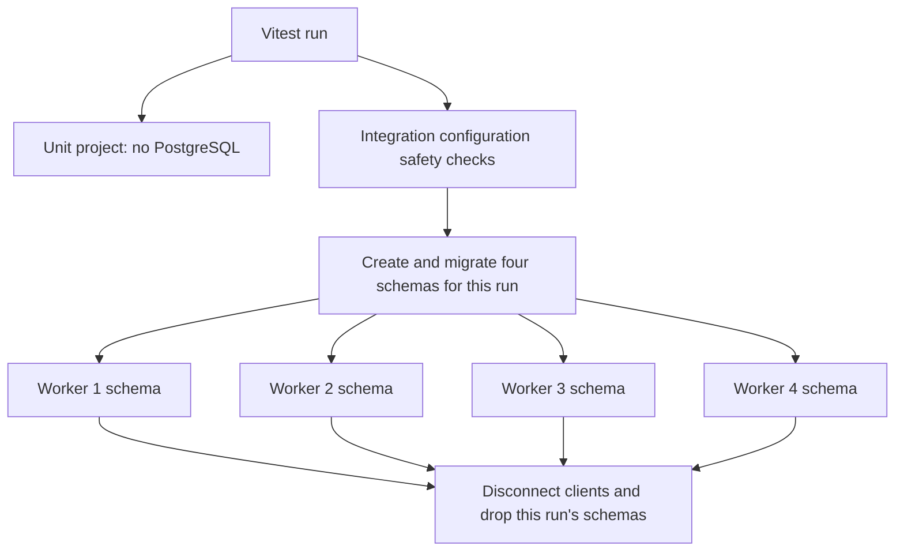

# Database Test Isolation

The backend has two Vitest projects. The unit project runs without PostgreSQL. The integration project uses a dedicated disposable database with one migrated schema per parallel worker.

## How A Test Run Works



1. `database.global-setup.ts` requires `NODE_ENV=test`, an explicit `TEST_DATABASE_URL`, and a database name with a separate `test` token, such as `eccommerce_test`. It never falls back to `DATABASE_URL`.
2. Global setup generates a random prefix such as `test_0123456789abcdef0123456789abcdef`. Schemas are named `<prefix>_worker_1` through `<prefix>_worker_4`, so simultaneous runs also remain separate.
3. Setup creates the schemas and applies the existing Prisma migration history to each using `prisma.test.config.ts`. Migration deployment is sequential because Prisma uses a database-wide advisory lock. Test files remain parallel.
4. Vitest passes the base URL and run prefix to workers through `provide`/`inject`. `integration.setup.ts` derives a URL using `VITEST_POOL_ID`, then dynamically imports Prisma. Pool IDs identify reusable worker slots; `VITEST_WORKER_ID` is a task identifier that can grow beyond the pool size.
5. Before each integration file, shared infrastructure truncates only application tables inside that run's current worker schema. `_prisma_migrations` is preserved. This clears singleton records left by a previous file on the same worker. The reset does not use `CASCADE`, so an accidental cross-schema foreign key fails instead of extending deletion into unowned tables.
6. Module tests keep deterministic, descriptive fixtures and scoped cleanup. The pricing administration suite additionally removes its owned settings, currencies, and exchange rates between tests.
7. Shared `afterAll` owns Prisma disconnection. Stack hook ordering runs module cleanup first. Global teardown attempts to remove every schema created by this run, including cleanup after partially failed provisioning. Infrastructure connections and queries have bounded timeouts so a blocked reset or drop fails instead of hanging indefinitely.

The PostgreSQL adapter receives both a schema option and a schema-specific URL. Its test-only PostgreSQL search path also contains only the worker schema, keeping unqualified raw SQL away from `public`. URL-level PostgreSQL connection `options` are rejected so a caller cannot override that search path. Prisma rejects test access unless the integration setup supplied the exact connection expected for the current run and worker.

## Files And Responsibilities

| File                                                         | Responsibility                                                     |
| ------------------------------------------------------------ | ------------------------------------------------------------------ |
| `src/shared/config/test-database.ts`                         | URL safety, worker identity, and schema ownership                  |
| `src/shared/config/tests/test-database.test.ts`              | Database-free safety regression tests                              |
| `vitest.config.ts`                                           | Shared fork-pool size and teardown settings                        |
| `vitest.workspace.ts`                                        | Unit/integration selection and setup registration                  |
| `prisma.test.config.ts`                                      | Migration datasource restricted to the isolated integration worker |
| `src/shared/testing/database.global-setup.ts`                | Schema creation, migration replay, and final teardown              |
| `src/shared/testing/test-database-lifecycle.ts`              | Guarded worker reset and schema removal                            |
| `src/shared/testing/integration.setup.ts`                    | Worker configuration and central Prisma lifecycle                  |
| `src/shared/testing/unit.setup.ts`                           | Clear inherited integration worker configuration                   |
| `src/shared/testing/vitest.d.ts`                             | Type-safe provided configuration                                   |
| `src/shared/testing/tests/test-database.integration.test.ts` | Actual database, raw SQL, and Prisma isolation regression tests    |
| `tsconfig.json`                                              | Check production code, tests, seeds, and tool configuration        |
| `tsconfig.build.json`                                        | Compile only production application code into `dist/`              |
| `../.github/workflows/server-ci.yml`                         | Independent unit and disposable PostgreSQL integration jobs        |

## Local Commands

Run database-free unit tests from `server`:

```powershell
npm.cmd run test:unit
```

For integration tests, first add the `TEST_DATABASE_URL` from `server/.env.example` to your local `server/.env`. Keep the development `DATABASE_URL` separate. Then run from the project root:

```powershell
docker compose -f docker-compose.test.yml up -d --wait
```

Run the suite from `server`:

```powershell
npm.cmd run test:integration
```

The test command itself applies existing migrations to temporary worker schemas. Do not separately migrate the development database for this test setup. No new application schema migration is required.

To run both projects from `server`:

```powershell
npm.cmd run test
```

Destroy the local test service from the project root when finished:

```powershell
docker compose -f docker-compose.test.yml down
```

The Compose service uses a separate PostgreSQL instance on port `5434` with disposable storage. The development instance remains on port `5433`.

If the parent shell explicitly sets `NODE_ENV` to development or production, both projects refuse to run. Set it to test for that session:

```powershell
$env:NODE_ENV = "test"
```

## Adding Tests

- Keep module tests in `src/modules/<module>/tests/` and infrastructure tests under the nearest shared `tests/` directory.
- Pure tests named `*.unit.test.ts`, `*.logic.test.ts`, or `*.validation.test.ts` belong to the unit project. The authentication middleware test is also explicitly selected as a database-free test.
- Other `src/**/*.test.ts` files belong to integration. This includes the health application test because it imports the complete Express application. A unit test that imports Prisma fails before connecting; it must instead test pure logic or belong to integration.
- The health application test uses Supertest against the exported application and verifies its real route registrations. It does not start a network listener; a running-server smoke test is tracked separately for CI and deployment checks.
- Database tests must not own Prisma disconnection or perform unscoped cleanup of unowned records. Use test-specific identifiers and `where` filters.
- Tests sharing one worker schema must remain sequential within each file. Do not add `it.concurrent` or `describe.concurrent` to database tests without a separate isolation design for their singleton fixtures.
- Application migrations must remain schema-neutral. Raw SQL that explicitly names `public` or accesses another schema bypasses the intended isolation boundary and needs review.
- Change the shared `INTEGRATION_WORKER_COUNT` when changing pool capacity. An unprovisioned pool ID is rejected before Prisma access.

## CI And Deliberate Limitations

CI has an independent unit job without a database service and an integration job with a disposable PostgreSQL service. Both generate Prisma Client from the committed schema. Integration setup replays committed migrations and runs files in parallel. A final `always()` step removes the PostgreSQL service, covering interrupted test execution as well as normal schema teardown. Actions are pinned to verified release commits, and repository permissions are read-only.

A forcibly terminated local runner may not execute JavaScript teardown. Run-specific schema names prevent collisions on the next run, and stopping the disposable Compose service removes its database storage. This design does not promise cleanup after an operating-system crash.

The existing HTTP tests continue to use in-memory session storage in test mode. They exercise authentication, authorization, and commerce database behavior, but do not verify production PostgreSQL session persistence. Add dedicated session-store integration coverage before claiming that behavior is tested.

Production builds exclude tests and shared test infrastructure. Type checking uses a separate configuration that includes them, so a build does not ship the Vitest database provisioning tools.
